
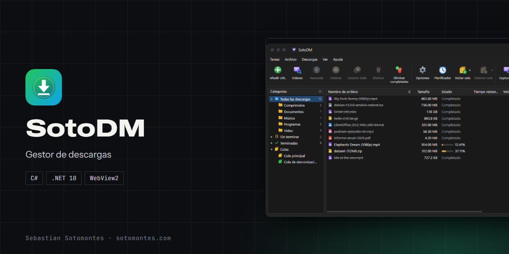

Gestor de descargas con segmentación dinámica, colas, planificador, video, BitTorrent y extensión de navegador.

<a href="https://sotomontes.com/#veloxdm"><b>Ver en sotomontes.com</b></a> · <a href="#cómo-se-usa">Cómo se usa</a> · <a href="#temas">Temas</a> · <a href="#cómo-funciona-por-dentro">Cómo funciona</a> · <a href="#novedades">Novedades</a>

| Ficha técnica | |
|---|---|
| **Autor** | Sebastian Sotomontes |
| **Tipo** | Gestor de descargas |
| **Plataforma** | Windows 10 y 11 (64 bits) |
| **Versión** | 0.8.1 |
| **Estado** | Funcional |
| **Stack** | C# · .NET 10 · WebView2 |
| **Precio** | Gratis |
| **Código** | Privado. Esta página es solo una presentación. |

---

## Qué es

SotoDM es un gestor de descargas para Windows pensado para bajar archivos grandes sin perder el progreso. Divide cada descarga en varias conexiones que trabajan en paralelo y, cuando una termina, ayuda a la más lenta para que el total baje lo más rápido posible. Reanuda después de un corte de internet, un reinicio o un apagón, sin empezar de cero.

Además de archivos normales por **HTTP, HTTPS y FTP**, baja **vídeo** de YouTube y más de mil sitios (con la calidad que elijas), **torrents**, y **paquetes de enlaces** de sitios de alojamiento. Se integra con tu navegador mediante una extensión, así que las descargas se capturan solas —con su sesión, cookies y referer— sin que tengas que copiar nada a mano.

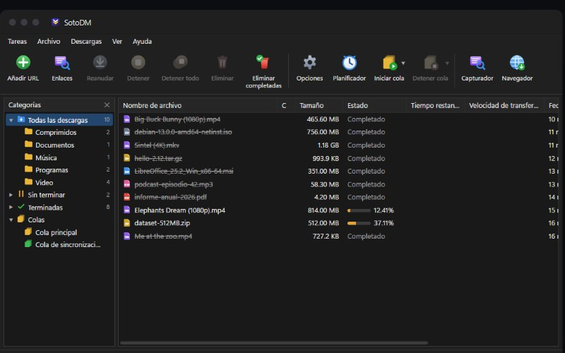

## Novedades

**Versión 0.8.1**

- **megaup.net** integrado en el capturador de enlaces, con carpetas y subcarpetas completas.
- **Abrir en el navegador** y **copiar dirección** desde el clic derecho del capturador.
- Coincidencia más tolerante al adoptar una descarga hecha en el navegador (mayúsculas y guiones bajos).
- Arreglo del letrero animado del tema 90s.

**Versión 0.8.0**

- **MEGA completo**: archivos y **carpetas** públicas (cada subcarpeta entra como su propio paquete), descarga que se **reanuda** tras un corte y **comprobación de integridad** antes de guardar el archivo.
- **megaup.net**: lee carpetas y subcarpetas con sus nombres y tamaños reales, y respeta la espera del sitio antes de descargar.
- **Abrir en el navegador** desde el capturador de enlaces (clic derecho), también para varios enlaces a la vez.
- **Claves y contraseñas cifradas** con la protección de Windows: cuenta debrid, inicios de sesión de sitios y proxy.
- Si un sitio solo deja ver un vídeo en su reproductor, SotoDM lo dice con claridad en lugar de reintentar sin fin.

**Versión 0.7.0**

- **Nuevo nombre: SotoDM.** Al actualizar, tus descargas, ajustes y temas se trasladan solos.
- **Servicios debrid** (Real-Debrid y AllDebrid): con tu cuenta, los enlaces de sitios de alojamiento se desbloquean sin esperas ni captchas.
- **Reglas de automatización**: cuando una descarga termina, la mueve, la renombra, la descomprime, abre un programa o te avisa, según el sitio, el tipo o el tamaño.
- **Panel de estadísticas** con lo descargado hoy, en el mes, en los últimos 14 días, por sitio y por categoría.
- **Ventana flotante «Soltar aquí»**, **modo portable** (desde una USB, sin instalar) y **modo gamer**, que baja la velocidad mientras juegas o ves algo a pantalla completa.
- Los temas se pueden **exportar e importar** como un archivo para compartirlos.

**Versión 0.6.0**

- **Diez temas visuales**, cada uno con sus colores, sus iconos de barra y una escena animada en la franja inferior. Los tienes todos más abajo, en [Temas](#temas).
- **Creador de temas** con vista previa en vivo: paleta, letra, tus propias imágenes como iconos y una imagen o escena de fondo.
- **MediaFire** recorre las subcarpetas, y las direcciones escritas sin `https://` se reconocen.

**Antes**

- Si un sitio exige una verificación, la descarga abre tu navegador para que la resuelvas tú; nada se salta.
- Tabla de 1311 sitios de alojamiento y motores por plataforma.
- Capturador de enlaces propio con complementos por sitio.
- Barra de progreso de vídeo con el tamaño total desde el inicio.

## Cómo se usa

1. Instala SotoDM y añade la extensión a tu navegador. Desde ese momento las descargas se capturan solas, con su sesión, cookies y referer.
2. Para bajar algo a mano, pulsa **Añadir URL**, pega el enlace y elige carpeta y categoría. En los vídeos eliges también la calidad.
3. Sigue el avance en la ventana principal. Al abrir una descarga ves cómo progresa cada conexión y puedes pausarla o cambiar su velocidad.
4. Agrupa las descargas en **colas** y abre el **planificador** para decidir qué días y a qué horas corren, y qué hacer al terminar.
5. Para muchos enlaces, pega un texto o una página en el **capturador de enlaces**: revisa cuáles siguen vivos y los agrupa en paquetes con su carpeta y contraseña.
6. En **Opciones** configuras límites, cuota de datos, velocidad por horario, proxy, sonidos y control desde el móvil; y en **Opciones → Apariencia** eliges el **estilo** o abres el **creador de temas**.

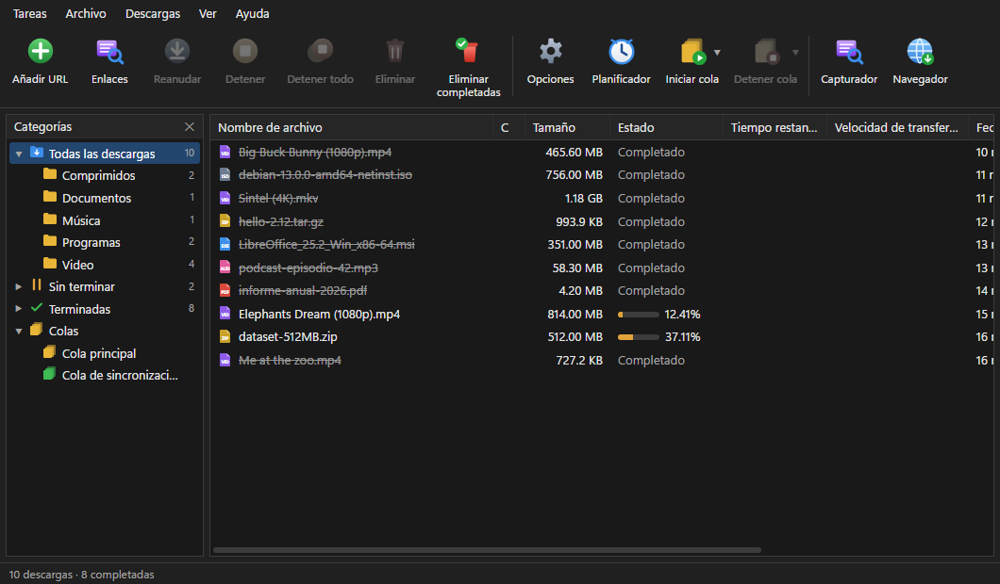 Ventana principal

 Progreso por conexiones

 Elegir calidad de un vídeo

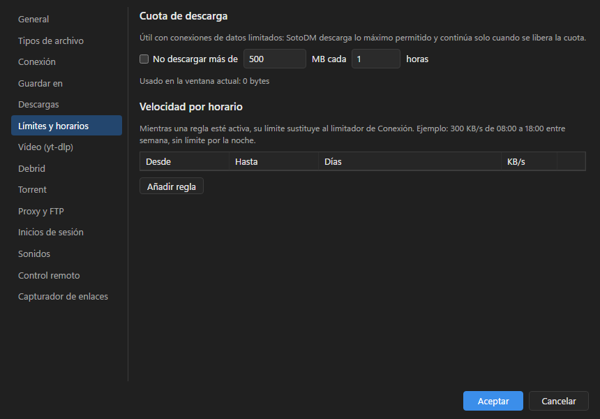 Límites y horarios

## Temas

SotoDM trae diez estilos. Cada uno no solo cambia los colores: también cambia los **iconos de la barra de herramientas** y añade una **escena animada en pixel art** en la parte de abajo de la ventana. El estilo claro u oscuro de Windows se sigue respetando salvo donde el tema fija sus propios colores. Se eligen en **Opciones → Apariencia → Estilo**.

<table>
<tr>
<td width="50%" valign="top"> <b>Clásico</b> La interfaz de siempre, limpia, en claro u oscuro según Windows.</td>
<td width="50%" valign="top">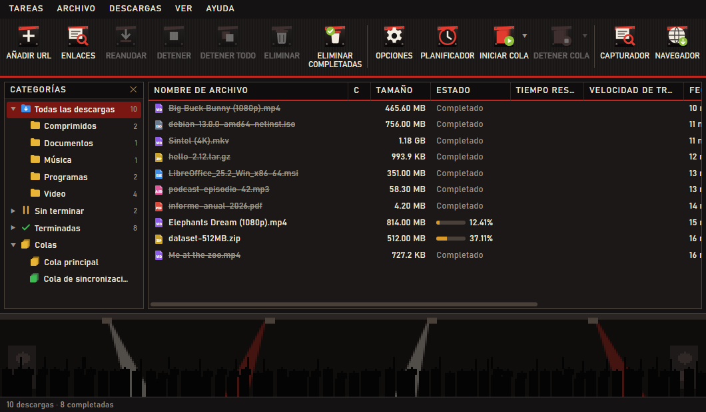 <b>Rock</b> Negro, hueso y rojo sangre; metal gastado, letra condensada y un concierto con luces y público al fondo.</td>
</tr>
<tr>
<td width="50%" valign="top">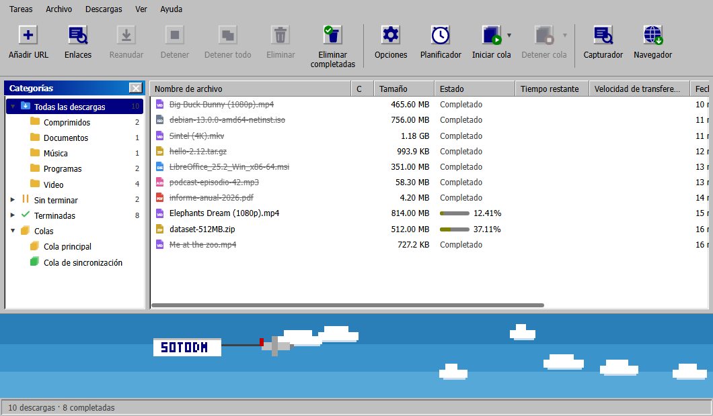 <b>Años 90</b> El escritorio gris de siempre, bordes en relieve y una avioneta con pancarta cruzando el cielo.</td>
<td width="50%" valign="top">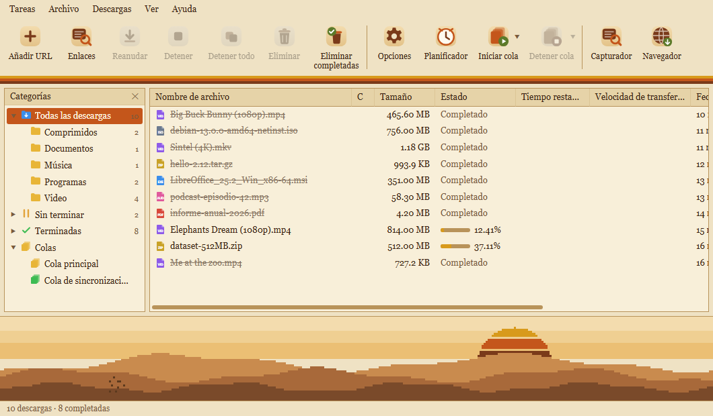 <b>Retro</b> Los setenta: crema, naranja quemado y mostaza, letra serif, con dunas y un sol a franjas.</td>
</tr>
<tr>
<td width="50%" valign="top">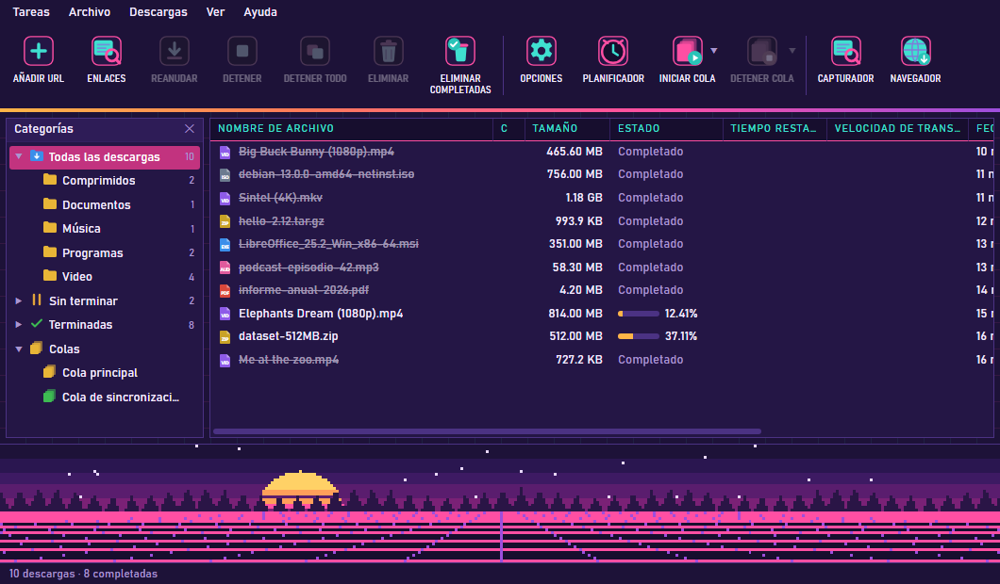 <b>Synthwave</b> Atardecer ochentero en morado, magenta y cian, con sol a franjas y una rejilla en fuga.</td>
<td width="50%" valign="top">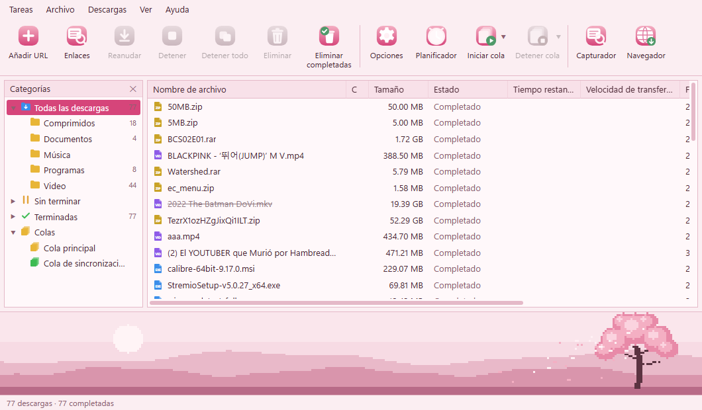 <b>Sakura</b> Rosa y ciruela, con un cerezo que deja caer sus pétalos abajo a la derecha.</td>
</tr>
<tr>
<td width="50%" valign="top">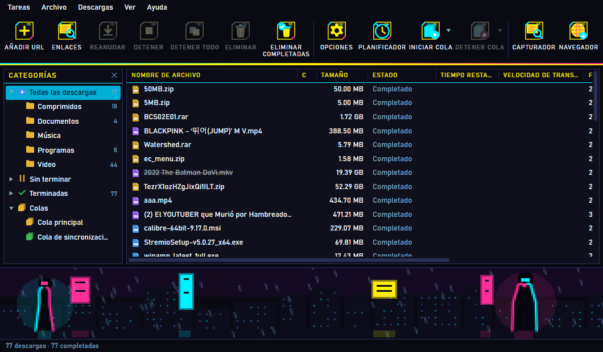 <b>Cyberpunk</b> Noche de neón bajo la lluvia, con dos siluetas iluminadas sobre la calle mojada.</td>
<td width="50%" valign="top">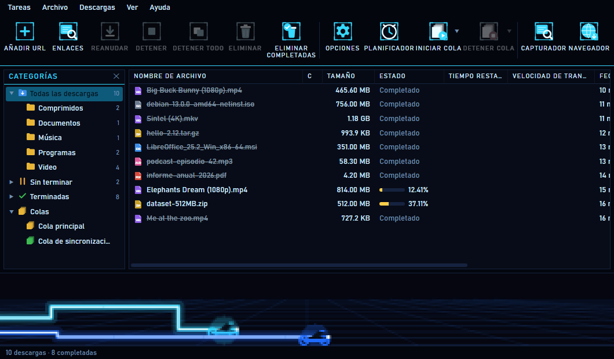 <b>Rejilla azul</b> Estilo Tron: negro absoluto, rejilla de luz y dos motos que dejan su estela.</td>
</tr>
<tr>
<td width="50%" valign="top">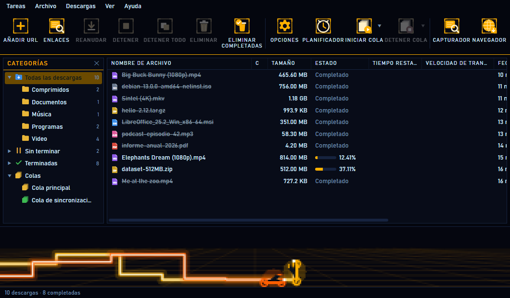 <b>Rejilla ámbar</b> La misma rejilla Tron, en ámbar incandescente.</td>
<td width="50%" valign="top">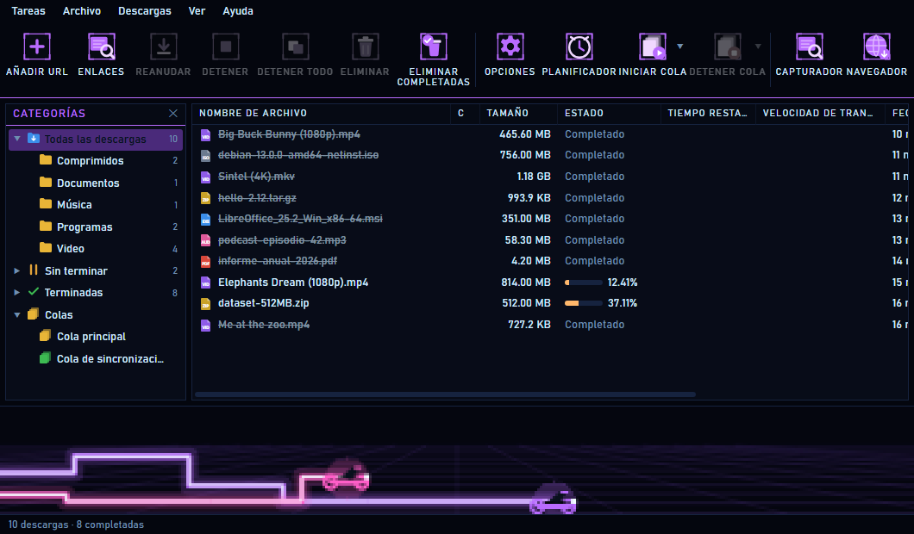 <b>Rejilla violeta</b> La misma rejilla Tron, en violeta.</td>
</tr>
</table>

### Creador de temas

¿Ninguno te encaja? Haz el tuyo. El **creador de temas** (Opciones → Apariencia → *Crear o editar temas…*) tiene una paleta de 17 colores, esquema claro u oscuro, redondez y tipo de letra; te deja **subir tus propias imágenes** como iconos de cada botón y poner de fondo una **escena integrada o tu propia imagen** (PNG, JPG o GIF animado). «Empezar desde» copia cualquier estilo existente como punto de partida, y todo se ve en una **vista previa en vivo** mientras lo editas. Tus temas aparecen luego junto a los demás en el selector de estilo.

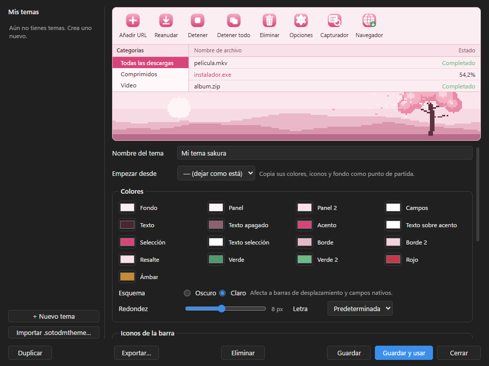 Creador de temas con vista previa en vivo

## Funciones

- **HTTP, HTTPS y FTP** con hasta 32 conexiones y segmentación dinámica.
- **Vídeo** de YouTube y más de 1000 sitios, con calidad a elegir, MP4 o solo audio, además de HLS y DASH.
- **BitTorrent**: enlaces magnet y archivos `.torrent`, con selección de archivos.
- **Extensión de navegador** para Chrome, Edge, Brave, Vivaldi y Opera.
- **Colas y planificador** con días, horas y acciones al terminar.
- **Capturador de enlaces** y paquetes con carpeta y contraseña.
- **Después de descargar**: verificación de sumas, descompresión y antivirus.
- **Control desde el móvil** en la red local con PIN.
- **Temas**: diez estilos con iconos y escena animada propios, más un creador para hacer el tuyo.

## Detalles

- Reanuda tras cortes de internet, reinicios o apagones.
- Hasta 32 conexiones por archivo con segmentación dinámica.
- Los archivos por partes se descomprimen solos al terminar, probando tu lista de contraseñas.
- Si un sitio pide una verificación, SotoDM abre la página para que la resuelvas tú; nada se salta.
- La apariencia es tuya: diez temas de serie y un creador para diseñar los que quieras, sin tocar código.
- Línea de comandos para usarlo desde scripts.

## Cómo funciona por dentro

### Arquitectura

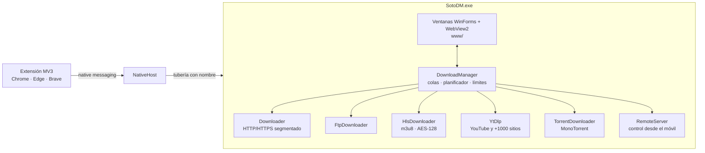

### Estructura

| Ruta | Contenido |
|---|---|
| `src/SotoDM/Core/Downloader.cs` | Motor HTTP(S): segmentación dinámica, archivo temporal disperso, reanudación |
| `src/SotoDM/Core/FtpDownloader.cs` | FTP con la misma segmentación (REST) |
| `src/SotoDM/Core/HlsDownloader.cs` | HLS: variantes, segmentos en paralelo, AES-128, remux a MP4 |
| `src/SotoDM/Core/YtDlp.cs` | Motor yt-dlp (sondeo de calidades, progreso, unión con ffmpeg) |
| `src/SotoDM/Core/TorrentDownloader.cs` | BitTorrent (MonoTorrent), límites compartidos con el resto |
| `src/SotoDM/Core/DownloadManager.cs` | Lista, colas, planificador, velocidad, acciones al terminar |
| `src/SotoDM/Core/SiteGrabber.cs` | Capturador de sitios |
| `src/SotoDM/Core/RemoteServer.cs` | Control remoto HTTP en la red local |
| `src/SotoDM/Core/LinkGrabber.cs` | Capturador de enlaces: análisis de texto y páginas, comprobación, paquetes |
| `src/SotoDM/Core/Hosters.cs`, `FilePlatforms.cs` | Complementos de sitios y motores de plataformas compartidas |
| `src/SotoDM/Core/Packages.cs` | Fin de paquete: descompresión, contraseñas y aviso |
| `src/SotoDM/Core/Themes.cs` | Temas de usuario: paleta, iconos y fondo propios |
| `src/SotoDM/Core/ClickNLoad.cs` | Receptor Click'n'Load |
| `src/SotoDM/Core/NativeHost.cs`, `Ipc.cs` | Host de native messaging y tubería con la app |
| `src/SotoDM/Ui/`, `src/SotoDM/www/` | Ventanas WinForms + WebView2 y su interfaz HTML/JS (temas, iconos y escenas incluidos) |
| `installer/SotoDM.iss` | Instalador Inno Setup (por usuario, sin administrador) |

### Cómo captura el navegador

La extensión pausa la descarga en `downloads.onDeterminingFilename` y se la entrega a la app por native messaging con URL, cookies, referer, user-agent y cabeceras. Si la app no responde, reanuda la descarga en el navegador, así nunca se pierde un archivo.

**Créditos:** usa yt-dlp, MonoTorrent y ffmpeg.

---

© 2026 Sebastian Sotomontes. Todos los derechos reservados.
